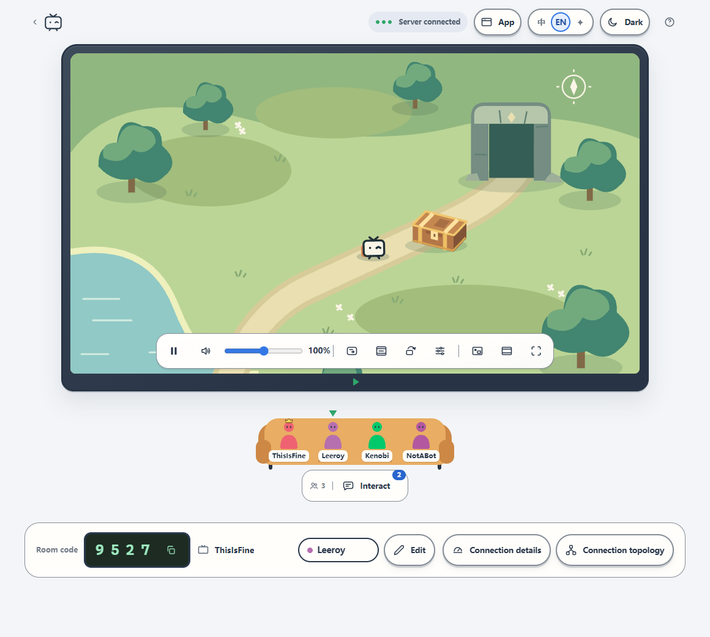

<h1 align="center">VibePiik</h1>
<p align="center"><strong>Piik v2.5.3 for Windows, with PIIK TV support and smoother 60 fps sharing.</strong></p>
<p align="center">English · <a href="./README.it.md">Italiano</a> · <a href="./README.zh-CN.md">简体中文</a></p>

VibePiik is a modified build of [Piik](https://github.com/TNTcraftHIM/Piik) v2.5.3
(revision `f2f9d27`) for Windows x64. It adds the features that pair it with
**PIIK TV**, an Android TV app that plays Piik rooms on a television, and fixes
that make 60 fps sharing smoother.

> VibePiik is not an official Piik release and is not supported by the Piik
> developers. Please report VibePiik problems here, not to the Piik project.

## What is different from Piik v2.5.3

### Watch on a TV
- **Send URL to PIIK TV app** button in the room header: sends the room link,
  with its invitation, to every PIIK TV app open on the local network. The App
  finds the TVs by itself (TCP port 8790): there is no address to type.
- **Watch on TV with the PIIK TV app** card on the App start page: paste any
  Piik room link, also someone else's, and send it to the TV, even before you
  start sharing.
- Both are answered only for the Piik pages on this PC (loopback, same origin):
  never for visitors who come through the public link, never for other devices
  on the network.
- The App only reaches TVs on the same local network: every private IPv4 network
  of the PC, whole up to a /22 (1022 addresses, as some mesh routers use), else
  the /24 around the PC. A search takes well under a second on a home network.

### A native window, no browser (`piik-app.exe`)
- The App's start page and host room are drawn **natively** (Go + [Gio](https://gioui.org))
  in a VibePiik window, with the same look as Piik's web pages: no browser and
  no WebView. While sharing it uses about 150–250 MB and well under 1% of the CPU,
  which matters while gaming.
- Everything the Piik host page does is there: screens and windows to share,
  quality (presets or typed values), source sound and app exclusion, commentary
  microphone, room code and password, invitations, remote control, room voice,
  chat and reactions, connection details and topology, help and a diagnostic
  report.
- Languages: **中 / EN / IT / ✦** at the top right (Chinese, English, Italian and
  Piik's visual mode). The first start follows Windows; any other language uses
  English. In ✦ mode the hints stay in the language chosen before.
- Closing the window quits the App, like `q` in the console. Its size and
  position are remembered (`%LOCALAPPDATA%\VibePiik`).
- In the console, **[o] Open in browser** moves the App to the system browser.
  While a share is running the window comes to the front and asks first: the
  share stops and is started again from the browser. **[w] Open in window**
  brings the window back. `piik-app.exe -browser` starts in the browser as Piik
  does.
- **Join a room** opens the viewer page in the browser.

### Extras of the native window
- **Chat on screen**: messages scroll over the TV picture, and **chat over other
  apps** shows messages and reactions in a corner of a chosen screen, above a
  game. It is a separate click-through window that never takes the focus and
  never touches the game's process (no injection, no graphics hooks), so it is
  safe with anti-cheat systems; it is left out of screen captures. The game must
  run borderless or windowed.
- **Detachable panels**: Interactions and Remote control open in their own
  always-on-top windows. Panels move and resize with the mouse or, once
  focused, with the arrow keys.
- **Local preview**: pause, fit / fill / stretch, theater, full screen and
  picture in picture (shared windows). For a shared screen, the ⚡ button under
  the TV switches to a **sharp preview** at 30 or 60 fps instead of the light
  one updated every 3 s (it uses more CPU).
- **Room voice**: microphone and volume, master and per-person volume, Windows
  noise & echo reduction, and a **noise gate** whose threshold sits on the
  microphone level meter. In room voice a screen share leaves VibePiik's own
  sound out, so nobody hears their voice come back (Windows can leave out one
  application only: your choice returns when you leave the voice).
- Piik's animated comics, title frames and playful waiting lines, the couch
  that grows rows for big rooms, and keyboard navigation.

### Updates
- The App checks [VibePiik's own releases](https://github.com/Kaitonume/VibePiik/releases)
  and shows a notice in the start page, in Help and on the App button when a
  newer one is out. It never offers official Piik releases: installing one would
  remove VibePiik. (Pages opened in the browser keep Piik's own notice.)
- This is VibePiik **v1.0.0**. Releases are tagged `vMAJOR.MINOR.PATCH` and carry
  `VibePiik-windows-amd64.zip`.

### No 3-second freezes on Wi-Fi viewers (`piik-app.exe`)
- AMD hardware encoders put an SVC *prefix NAL unit* (type 14) before every
  slice. AVC decoders ignore it, but it was sent as its own 5-byte RTP packet at
  the start of each frame. When Wi-Fi delivered that packet after the slice that
  ends the frame, libwebrtc's H.264 packet buffer completed the frame without it
  and kept the late packet as a frame that never ends: every following frame
  waited for a keyframe, about 3 s later. SVC NAL units (types 14, 15, 20) are now
  removed before packetization. Measured on a Wi-Fi TV with 15 s still / 15 s
  motion: 6 freezes in 120 s before, none in 240 s after.

### Smoother capture (`runtime/native/piik-capture.exe`)
- **No captured frame is dropped.** The cadence grid that discarded frames
  arriving "early" (real video frames, irregular on a high refresh rate desktop)
  is replaced by a token bucket: at most 60 frames per second on average, with a
  burst of 2. A frame that arrives too soon waits for the next token instead of
  being thrown away.
- **30 s GOP.** No periodic keyframe every 2 s (each one weighs about eight
  normal frames and arrived late); keyframes come when a viewer asks for one.
- **AMD hardware encoder.** Windows can list the integrated GPU's H.264 encoder
  first, which stalled when capturing from a discrete card; the encoder whose PCI
  ID matches the selected adapter is now tried first. Constrained Baseline is
  requested explicitly (with a Baseline fallback), because the AMD encoder did not
  flag its Baseline stream as constrained.
- **Still screens stay sharp.** Windows delivers no frames while the shared
  picture does not change, so the server marked every quality layer as stopped
  after 2 s and viewers asked for a keyframe after 3 s: a still screen kept
  switching between 1080p and 540p, every frame a keyframe. The latest picture is
  now repeated once per second (like WebRTC's own screen sharing), as a delta
  frame of a few dozen bytes.
- Optional diagnostics: environment variable `PIIK_CAPTURE_DEBUG=1` (cadence
  counters) or `PIIK_CAPTURE_DEBUG=2` (one log line per frame).

### Defaults
- New shares start on **High FPS**: 1080p, 60 fps, **12 Mbps** (Piik: 8 Mbps),
  balanced picture preference, **H.264** video codec (Piik: automatic). Everything
  can still be changed while sharing.

### Languages
- The native window is in Chinese, English and Italian. The PIIK TV texts follow
  it in English and Chinese, and are in Italian on an Italian Windows. Pages
  opened in the browser are Piik's (English and Chinese, following the browser).

## Download and run

1. Download `VibePiik-windows-amd64.zip` from the Releases page.
2. Extract it anywhere and run `piik-app.exe`, exactly like the official Piik
   package. Nothing is installed. Keep VibePiik in its own folder: do not mix its
   files with an official Piik folder.

The files are not code-signed (the official Piik files are not either), so
Windows SmartScreen may ask for confirmation the first time.

Everything else works as in Piik: see the [original README](#about-piik) below
and the [Piik documentation](https://piik.tv/docs/?lang=en).

## Compatibility

- Same room protocol as Piik v2.5.3: viewers watch VibePiik rooms exactly as
  they watch Piik rooms.
- The App identifies itself as Piik v2.5.3 to rooms and sites. Installing an
  official Piik release replaces VibePiik's changes.
- PIIK TV and its link receiver are optional: without a TV, VibePiik behaves like
  Piik with the capture fixes and defaults above.

## Building from source

The build is the same as Piik's (see [Run from source](./docs/README.md#run-from-source)):
Go 1.27, Node.js 24, then

```powershell
npm ci
npm run build:web
$env:GOOS = "windows"; $env:GOARCH = "amd64"; $env:CGO_ENABLED = "0"
go build -trimpath -ldflags "-s -w -X github.com/TNTcraftHIM/Piik/internal/app/buildinfo.Revision=f2f9d27db66565f9234c16d46ddd10f4d143cc16 -X github.com/TNTcraftHIM/Piik/internal/app/buildinfo.Release=v2.5.3" -o piik-app.exe ./cmd/piik-app
```

The native capture (`native/capture/windows`) builds with the Visual Studio 2022
Build Tools, as in Piik. The release package has the same layout as the official
`piik-app-windows-amd64.zip`: `piik-app.exe`, `runtime/native/piik-capture.exe`,
`runtime/tunnel/cloudflared.exe` (unchanged), `LICENSE`, `REVISION` and the
third-party notices. Piik's own packaging script (`scripts/assemble-app.mjs`)
expects a clean git checkout of an official release revision.

The native window is in `internal/app/nativeui` (pure Go, `CGO_ENABLED=0`).
`go test ./internal/app/nativeui` runs its tests; with `NATIVEUI_SHOTS` set to a
folder they also save rendered screenshots of the pages.

Tests: `go test ./...` and `npx vitest run`. The VibePiik changes come with their
own tests (`internal/piiktv`, `internal/app/launcher/piiktv_test.go`,
`internal/server/app/piiktv_test.go`, `tests/piiktv.test.ts`) and update the
quality tests to the new defaults.

## License

MIT, like Piik: see [LICENSE](./LICENSE) (Copyright (c) 2026 TNTcraft and Piik
contributors). The VibePiik changes are released under the same license.
Dependencies keep their own [licenses and notices](./licenses/README.md).

---

<a id="about-piik"></a>

# About Piik

*The original Piik README follows. Its download links point to the official Piik
releases, which do not include the VibePiik changes.*

<p align="center"></p>
<h1 align="center">Piik</h1>
<p align="center"><strong>Share the good stuff.</strong><br>Private screen sharing for you and up to 20 friends.</p>
<p align="center">
  <a href="https://piik.tv">Website</a> ·
  <a href="https://github.com/TNTcraftHIM/Piik/releases">Download</a> ·
  <a href="https://atomgit.com/TNTcraftHIM/Piik/releases">AtomGit mirror</a> ·
  <a href="https://demo.piik.tv">Use online</a> ·
  <a href="https://piik.tv/docs/?lang=en">Documentation</a>
</p>
<p align="center">
  <a href="./LICENSE"></a>
  
  
</p>
<p align="center">English · <a href="./README.zh-CN.md">简体中文</a></p>

Piik is a free, open-source screen sharing tool for private live streams with
friends: games, movie nights, drawings and photos. Choose what to share and send
an invitation. Your friends watch in their browsers. You can also self-host Piik
on your own server.

<details open>
<summary>A little room · Show / hide animation</summary>

<p align="center"></p>

</details>

[Features](#features) · [Get started](#get-started) · [Self-hosting](#self-hosting) · [Contributing](#contributing)

## Features

- **Watch without installing.** Friends join by invitation in a desktop or mobile browser.
- **Share from Piik App or an existing Piik site.** Choose a screen, window, browser tab or camera; available sources and audio depend on the platform.
- **Direct connections first.** Media travels between participants where possible (P2P). A self-hosted server can provide automatic media forwarding (SFU) as a fallback.
- **Rooms you control.** Invitations, room codes and optional room passwords, for one host and up to 20 viewers.
- **Talk and chat together.** Join room voice, send messages and reactions, or enable on-screen chat.
- **Hand control to friends.** Share an App window or screen and approve remote control. Allow friends to play together with shared keyboard/mouse or supported gamepads; take control back at any time. [Setup guide](./docs/guide/remote-control.md).
- **Flexible viewing.** Light and dark themes, playback controls, picture-in-picture and a connection topology view.
- **One program to host a site.** Web UI, room management and optional media forwarding are packaged together.

<p align="center">
  <picture>
    <source media="(prefers-color-scheme: dark)" srcset="./docs/assets/room-en-dark.png">
    
  </picture><br>
  <sub>Interface preview · Sample room with a generated game scene</sub>
</p>

## Get started

**To watch:** open the invitation your friend sends you. Select **Play** if the
picture does not start automatically.

**To share:** download **Piik App** to get started. To share without installing,
you can also create a room in the online version.

| Start here | What you need to do |
| --- | --- |
| [Use Piik online](https://demo.piik.tv) | Share from a desktop browser, or choose Camera on a phone with browser camera support. |
| [Download Piik App](https://piik.tv/#download) | Extract the desktop package or install the mobile app, open Piik, choose **Public invite**, then **Open Piik**. |

<p align="center"></p>

1. Select **Start sharing**, then choose the picture and audio to share.
2. Select **Copy invite link** and send it to your friends. Keep the sharing tab open.

Open **Interact → Voice** to talk together, with or without picture sharing.
The Host opens voice; everyone joins to listen and chooses when to turn on their microphone.

Piik follows your system language: Chinese or English, with English as the fallback.
Use **中 / EN / ✦** in the header to switch language or try the visual mode.
The App can create a local room or temporary public invitation, and stays
available to supply capture for an approved site. Keep it running while sharing.

[**Illustrated getting started →**](./docs/guide/getting-started.md) · [**Troubleshooting →**](./docs/guide/troubleshooting.md)

Choose a download beginning with **`piik-app`**. The guide covers installation,
source selection and invitations.

Browser capture requires HTTPS or `localhost`.
The App's temporary public link and the online version use P2P and need a usable
UDP connection between participants. For campus
networks, failed media connections or virtual LANs, see [network checks and connection options](./docs/guide/network.md).

## Self-hosting

Deploy Piik Server to run a site for your group.

<p><a href="./docs/operations/self-hosting.md#docker-compose"></a></p>

Piik Server runs on Windows x64 and Linux x64/ARM64, with the web interface built in.
Download the Server package for Linux x64 (`piik-<revision>-runtime.tar.gz`)
or ARM64 (`piik-<revision>-linux-arm64-runtime.tar.gz`),
extract it, and run:

```sh
./piik-server
```

Windows x64 uses `piik-<revision>-windows-amd64-runtime.zip`; extract it and run
`./piik-server.exe` in PowerShell. The same configuration applies.

Open `http://localhost:8787` to try it locally. For a public site, configure your
domain, HTTPS reverse proxy and STUN address. Room data is stored in SQLite.
For containers, use the [Docker Compose setup](./docs/operations/self-hosting.md#docker-compose).

[**Deploy your own site →**](./docs/operations/self-hosting.md) · [Configuration](./docs/standards/configuration.md) · [Run from source](./docs/README.md#run-from-source)

## Contributing

Bug reports, translations, documentation improvements and pull requests are welcome.
See [ways to contribute](./CONTRIBUTING.md#ways-to-help) or
[help translate Piik](./docs/guide/translating.md). Use the
[repository layout](./docs/standards/engineering.md#repository-layout) to find your way around.

## License

Piik-owned code is [MIT licensed](./LICENSE). Dependencies retain their own
[licenses and notices](./licenses/README.md).

## Project activity

<p align="center">
  <a href="https://trendshift.io/repositories/236065"></a>
</p>
<p align="center">
  <a href="https://www.star-history.com/#TNTcraftHIM/Piik&amp;Date">
    <picture>
      <source media="(prefers-color-scheme: dark)" srcset="https://api.star-history.com/svg?repos=TNTcraftHIM/Piik&amp;type=Date&amp;theme=dark">
      
    </picture>
  </a>
</p>
