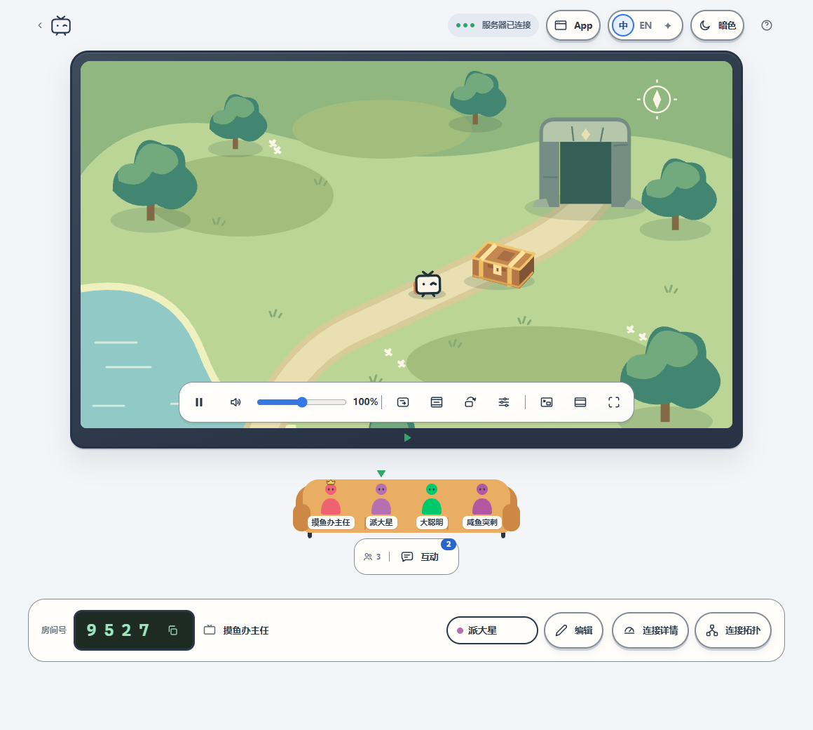

<h1 align="center">VibePiik</h1>
<p align="center"><strong>适用于 Windows 的 Piik v2.5.3，支持 PIIK TV，60 fps 分享更流畅。</strong></p>
<p align="center"><a href="./README.md">English</a> · <a href="./README.it.md">Italiano</a> · 简体中文</p>

VibePiik 是基于 [Piik](https://github.com/TNTcraftHIM/Piik) v2.5.3（修订版 `f2f9d27`）的
Windows x64 修改版。它增加了与 **[PIIK TV](https://github.com/Kaitonume/Piik-TV)**（一款在电视上播放 Piik 房间的 Android TV 应用）
配合使用的功能，并修复了若干问题，让 60 fps 分享更加流畅。

> VibePiik 不是 Piik 官方版本，也不受 Piik 开发者支持。VibePiik 的问题请在这里反馈，
> 不要提交到 Piik 项目。

## 与 Piik v2.5.3 的不同之处

### 在电视上观看
- 房间顶栏的 **将链接发送到 PIIK TV 应用** 按钮：把房间链接连同邀请信息发送到本地网络中所有已打开的
  PIIK TV 应用。App 会自动查找电视（TCP 端口 8790），无须输入地址。
- App 首页的 **使用 PIIK TV 应用在电视上观看** 卡片：粘贴任意 Piik 房间链接（也可以是别人的房间），
  发送到电视，开始分享之前也能用。
- 这两个功能只响应本机上的 Piik 页面（回环地址、同源）：通过公网链接访问的访客和网络中的其他设备都无法使用。
- App 只会连接同一本地网络中的电视：覆盖本机所有私有 IPv4 网络，网段最大到 /22
  （1022 个地址，部分 Mesh 路由器会使用），否则扫描本机所在的 /24。家庭网络中一次搜索远不到一秒。

### 原生窗口，无须浏览器（`piik-app.exe`）
- App 的首页和房主房间由 VibePiik 窗口**原生**绘制（Go + [Gio](https://gioui.org)），外观与
  Piik 网页一致：不用浏览器，也不用 WebView。分享时约占用 150–250 MB 内存，CPU 占用远低于 1%，
  玩游戏时尤其有用。
- Piik 房主页面的功能一应俱全：选择要分享的屏幕和窗口、画质（预设或手动输入）、来源声音与排除应用、
  解说麦克风、房间号和密码、邀请、远程控制、房间语音、聊天和表情、连接详情与拓扑、帮助和诊断报告。
- 语言：右上角的 **中 / EN / IT / ✦**（中文、英文、意大利文和 Piik 的纯视觉模式）。首次启动跟随
  Windows 语言，其他语言显示英文。✦ 模式下，提示文字保持之前选择的语言。
- 关闭窗口即退出 App，与在控制台按 `q` 相同。窗口大小和位置会被记住（`%LOCALAPPDATA%\VibePiik`）。
- 在控制台中，**[o] Open in browser** 会把 App 切换到系统浏览器。如果正在分享，窗口会切到前台并先询问：
  分享会停止，并在浏览器中重新开始。**[w] Open in window** 可切回窗口。`piik-app.exe -browser`
  则像 Piik 一样在浏览器中启动。
- **Join a room** 会在浏览器中打开观众页面。

### 原生窗口的额外功能
- **屏幕弹幕**：消息在电视画面上滚动；**在其他应用上方显示聊天** 则在所选屏幕的角落、游戏画面之上显示
  消息和表情。它是一个独立的鼠标穿透窗口，从不抢占焦点，也从不触碰游戏进程（无注入、无图形钩子），
  因此与反作弊系统兼容；屏幕采集时不会被录进去。游戏需要以无边框或窗口模式运行。
- **可分离面板**：互动和远程控制面板 可在各自的置顶窗口中打开。面板可用鼠标移动和调整大小，
  获得焦点后也可以用方向键操作。
- **本地预览**：暂停，适应 / 填充 / 拉伸，影院模式，全屏和画中画（分享窗口时）。分享屏幕时，
  电视下方的 ⚡ 按钮可切换为 30 或 60 fps 的**清晰预览**，代替每 3 秒更新一次的轻量预览（CPU 占用更高）。
- **房间语音**：麦克风和音量、总音量和每人音量、Windows 降噪与回声消除，以及阈值显示在麦克风电平表上的
  **噪声门**。在房间语音中，屏幕分享会排除 VibePiik 自身的声音，这样就没人会听到自己的回声
  （Windows 只能排除一个应用：离开语音后会恢复你原来的选择）。
- Piik 的动画漫画、标题框和俏皮的等待文案，大房间会自动加排的沙发，以及键盘导航。

### 更新
- **在 App 内安装。** 更新提示（App 按钮、帮助、首页）会打开更新日志；**立即安装** 会下载新版本、
  校验 SHA-256、替换 VibePiik 的文件并自动重启（正在进行的共享会先停止）。重要更新会自动弹出一次。
- App 会检查 [VibePiik 自己的发布版本](https://github.com/Kaitonume/VibePiik/releases)，
  有新版本时会在首页、帮助和 App 按钮上提示。App 从不推荐 Piik 官方版本：安装官方版本会移除 VibePiik。
  （在浏览器中打开的页面仍保留 Piik 自己的提示。）
- 当前为 VibePiik **v1.1.0**。发布版本的标签格式为 `vMAJOR.MINOR.PATCH`，附带
  `VibePiik-windows-amd64.zip`。

### Wi-Fi 观众不再卡顿 3 秒（`piik-app.exe`）
- AMD 硬件编码器会在每个切片前放一个 SVC *前缀 NAL 单元*（类型 14）。AVC 解码器会忽略它，但它原先在
  每帧开头作为单独的 5 字节 RTP 包发送。当 Wi-Fi 把这个包送到结束该帧的切片之后，libwebrtc 的 H.264
  包缓冲区会在缺少它的情况下完成该帧，并把迟到的包当作一个永远不会结束的帧保留下来：之后的每一帧都要
  等待关键帧，大约 3 秒后才恢复。现在 SVC NAL 单元（类型 14、15、20）会在打包前被移除。在 Wi-Fi
  电视上以 15 秒静止 / 15 秒运动的画面实测：修复前 120 秒内卡顿 6 次，修复后 240 秒内一次也没有。

### 更流畅的采集（`runtime/native/piik-capture.exe`）
- **不再丢弃任何采集到的帧。** 原先的节拍网格会丢弃“提前”到达的帧（这些是真实的视频帧，在高刷新率桌面上
  到达时间并不规律），现在改为令牌桶：平均每秒最多 60 帧，突发上限 2 帧。来得太早的帧会等待下一个令牌，
  而不是被丢弃。
- **30 秒 GOP。** 不再每 2 秒定期插入关键帧（每个关键帧大约相当于八个普通帧，而且会迟到）；
  只有观众请求时才发送关键帧。
- **AMD 硬件编码器。** Windows 可能把集成显卡的 H.264 编码器排在第一位，从独立显卡采集时会卡住；
  现在优先尝试 PCI ID 与所选适配器匹配的编码器。同时显式请求 Constrained Baseline（并以 Baseline
  作为备选），因为 AMD 编码器没有把它的 Baseline 码流标记为 constrained。
- **静止画面保持清晰。** 分享的画面不变时，Windows 不会送出任何帧，于是服务器在 2 秒后把所有画质层
  标记为已停止，观众在 3 秒后请求关键帧：静止画面会在 1080p 和 540p 之间来回切换，每一帧都是关键帧。
  现在最新画面每秒重复一次（与 WebRTC 自带的屏幕分享相同），以只有几十字节的差分帧发送。
- 可选诊断：环境变量 `PIIK_CAPTURE_DEBUG=1`（节拍计数）或 `PIIK_CAPTURE_DEBUG=2`（每帧一行日志）。

### 默认设置
- 新的分享默认使用 **High FPS**：1080p、60 fps、**12 Mbps**（Piik：8 Mbps），画面偏好为均衡，
  视频编码为 **H.264**（Piik：自动）。分享过程中仍可随时修改。

### 语言
- 原生窗口支持中文、英文和意大利文。PIIK TV 相关文字在中文和英文下跟随窗口语言，在意大利语 Windows
  上显示意大利文。在浏览器中打开的页面是 Piik 自己的页面（中文和英文，跟随浏览器语言）。

## 下载和运行

1. 从 [Releases 页面](https://github.com/Kaitonume/VibePiik/releases) 下载 `VibePiik-windows-amd64.zip`。
2. 解压到任意位置，运行 `piik-app.exe`，与 Piik 官方程序包完全相同，无须安装。请把 VibePiik
   放在单独的文件夹中，不要与 Piik 官方文件夹的文件混在一起。

文件没有代码签名（Piik 官方文件也没有），所以首次运行时 Windows SmartScreen 可能会要求确认。

其他功能与 Piik 相同：见下方的[原版 README](#关于-piik) 和 [Piik 文档中心](https://piik.tv/docs/zh/)。

## 兼容性

- 与 Piik v2.5.3 使用相同的房间协议：观众观看 VibePiik 房间与观看 Piik 房间完全一样。
- App 对房间和站点标识自己为 Piik v2.5.3。安装 Piik 官方版本会覆盖 VibePiik 的改动。
- PIIK TV 及其链接接收器是可选的：没有电视时，VibePiik 就是带有上述采集修复和默认设置的 Piik。

## 从源码构建

构建方式与 Piik 相同（见[从源码运行](./docs/README.md#run-from-source)）：
Go 1.27、Node.js 24，然后执行

```powershell
npm ci
npm run build:web
$env:GOOS = "windows"; $env:GOARCH = "amd64"; $env:CGO_ENABLED = "0"
go build -trimpath -ldflags "-s -w -X github.com/TNTcraftHIM/Piik/internal/app/buildinfo.Revision=f2f9d27db66565f9234c16d46ddd10f4d143cc16 -X github.com/TNTcraftHIM/Piik/internal/app/buildinfo.Release=v2.5.3" -o piik-app.exe ./cmd/piik-app
```

原生采集模块（`native/capture/windows`）与 Piik 一样使用 Visual Studio 2022 Build Tools 构建。
发布包的结构与官方 `piik-app-windows-amd64.zip` 相同：`piik-app.exe`、
`runtime/native/piik-capture.exe`、`runtime/tunnel/cloudflared.exe`（未修改）、`LICENSE`、
`REVISION` 以及第三方声明。Piik 自己的打包脚本（`scripts/assemble-app.mjs`）要求是官方发布修订版的
干净 git 检出。

原生窗口位于 `internal/app/nativeui`（纯 Go，`CGO_ENABLED=0`）。`go test ./internal/app/nativeui`
运行其测试；把 `NATIVEUI_SHOTS` 设为某个文件夹时，测试还会保存各页面的渲染截图。

测试：`go test ./...` 和 `npx vitest run`。VibePiik 的改动附带自己的测试（`internal/piiktv`、
`internal/app/launcher/piiktv_test.go`、`internal/server/app/piiktv_test.go`、
`tests/piiktv.test.ts`），并把画质相关测试更新为新的默认设置。

## 许可

与 Piik 一样采用 MIT 许可：见 [LICENSE](./LICENSE)（Copyright (c) 2026 TNTcraft and Piik
contributors）。VibePiik 的改动以相同许可发布。依赖保留各自的[许可与声明](./licenses/README.md)。

---

<a id="about-piik"></a>

# 关于 Piik

*以下是 Piik 原版 README。其中的下载链接指向 Piik 官方版本，不包含 VibePiik 的改动。*

<p align="center"></p>
<h1 align="center">Piik</h1>
<p align="center"><strong>来，看点<br>好康的。</strong><br>私密屏幕共享，邀请最多 20 位朋友观看。</p>
<p align="center">
  <a href="https://piik.tv/?lang=zh-CN">官网</a> ·
  <a href="https://github.com/TNTcraftHIM/Piik/releases">下载</a> ·
  <a href="https://atomgit.com/TNTcraftHIM/Piik/releases">AtomGit 镜像</a> ·
  <a href="https://demo.piik.tv">在线版</a> ·
  <a href="https://piik.tv/docs/zh/">文档中心</a>
</p>
<p align="center">
  <a href="./LICENSE"></a>
  
  
</p>
<p align="center"><a href="./README.md">English</a> · 简体中文</p>

Piik 是一个免费开源的私密屏幕共享工具，适合游戏直播、一起看电影、展示绘画或分享照片。
选择画面，把邀请链接发给朋友，对方用浏览器即可观看。也支持自部署，搭建自己的 Piik 站点。

<details open>
<summary>客厅小剧场 · 展开 / 收起动画</summary>

<p align="center"></p>

</details>

[功能](#功能) · [开始使用](#开始使用) · [自行部署](#自行部署) · [参与贡献](#参与贡献)

## 功能

- **观看无须安装。** 朋友通过邀请链接，用电脑或手机浏览器加入。
- **用 Piik App 或已有 Piik 站点分享。** 支持屏幕、窗口、浏览器标签页和摄像头；可选来源与音频能力取决于平台。
- **优先直接连接。** 画面优先在设备之间传输（P2P），自建站点可启用媒体转发（SFU）自动兜底。
- **房间由你管理。** 支持邀请链接、房间号和可选的房间密码，一位房主、最多 20 位观众。
- **边看边聊。** 加入房间语音，发送文字和表情，也可开启弹幕。
- **让朋友接手操作。** 通过 Piik App 分享窗口或屏幕并授权远控，也可允许多人共用键鼠或使用受支持的手柄一起玩，随时结束控制。[查看设置方法](./docs/guide/remote-control.zh-CN.md)。
- **灵活的观看方式。** 支持深浅主题、播放控制、画中画和连接拓扑查看。
- **一个程序就能建站。** 网页、房间管理和可选的媒体转发打包在同一服务端程序中。

<p align="center">
  <picture>
    <source media="(prefers-color-scheme: dark)" srcset="./docs/assets/room-zh-dark.png">
    
  </picture><br>
  <sub>界面预览 · 示例房间与生成的游戏画面</sub>
</p>

## 开始使用

**观看分享：** 打开朋友发来的邀请链接。画面没有自动播放时，点击**播放**即可。

**分享画面：** 推荐下载 **Piik App**。想免安装，也可以打开在线版直接创建房间。

| 从这里开始 | 需要做什么 |
| --- | --- |
| [使用在线版](https://demo.piik.tv) | 用电脑浏览器分享画面；手机浏览器支持摄像头访问时，也可选择摄像头分享。 |
| [下载 Piik App](https://piik.tv/?lang=zh-CN#download) | 电脑上解压程序包，手机或平板安装 App。打开 Piik，选择**公网邀请**，点击**进入 Piik**。 |

<p align="center"></p>

1. 点击**开始分享**，选择要分享的画面和声音。
2. 点击**复制邀请链接**，发给朋友。分享期间保持标签页打开。

打开 **互动 → 语音** 即可一起聊天，开播前后都能使用。
房主开启语音后，大家自行加入收听，想说话时再打开自己的麦克风。

Piik 默认跟随系统语言，中文系统显示简体中文，其他语言显示英文。
顶部的 **中 / EN / ✦** 可切换中英文或体验纯视觉模式。
Piik App 可创建本地房间或临时公网邀请，也能在后台为已授权站点提供采集能力。分享期间需保持 App 运行。

[**图文上手教程 →**](./docs/guide/getting-started.zh-CN.md) · [**问题排查 →**](./docs/guide/troubleshooting.zh-CN.md)

选择以 **`piik-app`** 开头的程序包；教程介绍安装、选择画面和邀请朋友的完整步骤。

浏览器采集需要 HTTPS 或 `localhost`。Piik App 的公网邀请和在线版使用 P2P，
参与者之间需要可用的 UDP 通路。校园网、画面连接失败或虚拟局域网的用法，见[网络排查与连接方案](./docs/guide/network.zh-CN.md)。

## 自行部署

部署 Piik Server，为朋友搭建自己的站点。

<p><a href="./docs/operations/self-hosting.zh-CN.md#使用-docker-compose"></a></p>

Piik Server 是内置网页界面的独立程序，支持 Windows x64 和 Linux x64／ARM64。
根据服务器架构下载 Linux x64 的 `piik-<revision>-runtime.tar.gz` 或 ARM64 的
`piik-<revision>-linux-arm64-runtime.tar.gz`，解压后运行：

```sh
./piik-server
```

Windows x64 可下载 `piik-<revision>-windows-amd64-runtime.zip`，解压后在 PowerShell
运行 `./piik-server.exe`；配置方式相同。

打开 `http://localhost:8787` 即可在本机试用。对外提供服务时，
再配置域名、HTTPS 反向代理和 STUN 地址。房间数据保存在 SQLite 中。
也可以使用 [Docker Compose 部署](./docs/operations/self-hosting.zh-CN.md#使用-docker-compose)。

[**部署自己的站点 →**](./docs/operations/self-hosting.zh-CN.md) · [配置参考](./docs/standards/configuration.md) · [从源码运行](./docs/README.md#run-from-source)

## 参与贡献

欢迎反馈问题、参与翻译、改进文档或贡献代码。
从[社区参与方式](./CONTRIBUTING.md#ways-to-help)或
[翻译教程](./docs/guide/translating.zh-CN.md)开始，也可以从
[项目目录说明](./docs/standards/engineering.md#repository-layout)了解代码结构。

## 许可

Piik 自有代码采用 [MIT 许可](./LICENSE)，依赖保留各自的[许可与声明](./licenses/README.md)。

## 项目动态

<p align="center">
  <a href="https://trendshift.io/repositories/236065"></a>
</p>
<p align="center">
  <a href="https://www.star-history.com/#TNTcraftHIM/Piik&amp;Date">
    <picture>
      <source media="(prefers-color-scheme: dark)" srcset="https://api.star-history.com/svg?repos=TNTcraftHIM/Piik&amp;type=Date&amp;theme=dark">
      
    </picture>
  </a>
</p>
